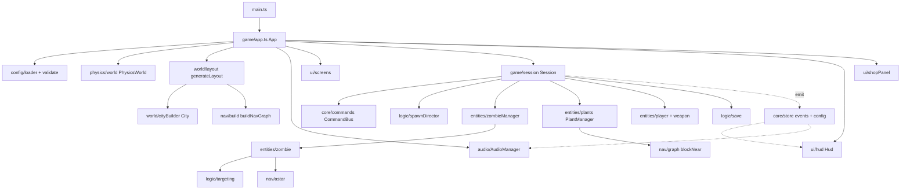
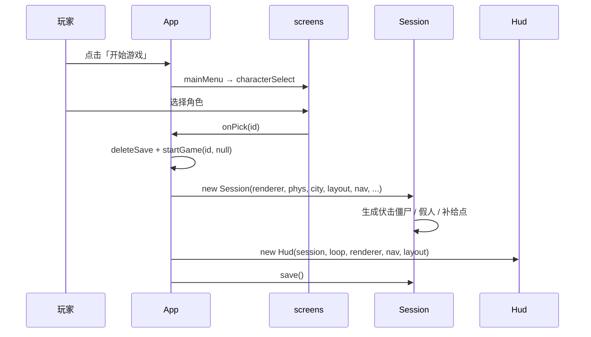
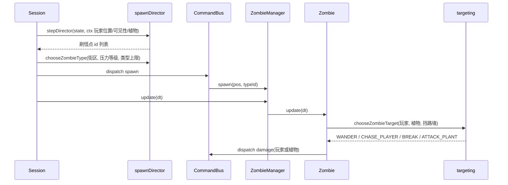

# 架构

## Architecture Analysis

### System Overview

单页浏览器游戏。`src/main.ts` 创建 `App`（`src/game/app.ts`），`App.boot()` 依次完成：加载并校验配置 → 初始化 Rapier → 生成城市布局并构建渲染 / 物理 → 构建航点图 → 加载音频 → 启动固定步长循环 → 显示主菜单。选择角色后创建 `Session`（`src/game/session.ts`），它装配玩家、武器、僵尸、植物、经济、商店、刷怪导演、拾取物与存档；`Hud` 与 `ShopPanel` 只观察 `Session`。

### Architectural Style

客户端单体（modular monolith），分层清晰：

- **纯逻辑层** `src/logic/`、`src/nav/`、`src/config/validate.ts`、`src/world/layout.ts`：不依赖 Three.js / Rapier / DOM，可在 Node 中单元测试。
- **实体层** `src/entities/`：持有物理体与渲染实例，调用纯逻辑做决策。
- **装配层** `src/game/`：`App`（UI 状态机 + 循环）与 `Session`（一局游戏）。
- **表现层** `src/render/`、`src/audio/`、`src/ui/`：订阅事件总线，不直接改世界状态。
- **横切** `src/core/`：`store` 单例（配置、设置、事件总线）、`CommandBus`（所有世界变更的唯一入口，AR-01）、`GameLoop`。

### Component Relationships

文本说明（Mermaid 不可用时）：`main` → `App`；`App` 调用配置加载、物理、布局（布局再交给 `City` 与航点构建）、音频、界面屏幕；开局时 `App` 创建 `Session`、`Hud`、`ShopPanel`。`Session` 通过 `CommandBus` 改世界，驱动刷怪导演、僵尸管理器、植物管理器、玩家与武器、存档。僵尸调用目标优先级与 A*；坚果墙通过 `NavGraph.blockNear` 改航点代价。`Session` 发事件到 `store.events`，`Hud` 与 `AudioManager` 订阅。

### Data Flow

1. **配置**：7 个 JSON 由 `loader.ts` 静态 import → `structuredClone` → `validateConfig` → `store.setConfig`。开发模式 HMR 重新校验，失败保留旧配置。
2. **世界**：`MapConfig` → `generateLayout`（纯数据 `CityLayout`：boxes、obstacles、navNodes、navEdges、doorLinks、buildings）→ `City`（InstancedMesh + 静态碰撞体）与 `buildNavGraph`（10 m 网格 + 室内节点 + 门连接）。
3. **每个固定步长**（60 Hz）：`Session.update` → 输入 → 玩家 → 经济 tick → `runDirector`（`stepDirector` 返回要刷的刷怪点 id → `chooseZombieType` → `spawn` 命令）→ `zombies.update` → `plants.update` → 拾取物 → 物理 step。
4. **事件**：逻辑发 `zombieKilled`、`sunChanged`、`banner` 等 → HUD / 音频 / 粒子响应。
5. **存档**：`Session.buildSave()` → `writeSave(localStorage)`，在开局、种植、购买、死亡、暂停、页面隐藏 / 关闭时写入。

### Key Design Decisions

- **命令总线（AR-01）**：所有世界变更走 `CommandBus.dispatch`，便于调试面板记录与后续扩展新命令。
- **纯逻辑可测**：目标优先级、刷怪导演、A*、布局、校验都是纯函数，有对应单元测试。
- **一次性构建世界**：城市、物理静态体、航点图在 `boot()` 时构建一次，跨 Session 复用；`Session.dispose()` 只清理它自己创建的场景对象。
- **统一攻击接口（AR-04）**：玩家、僵尸、植物都实现 `IAttackable`（`logic/attackable.ts`）。
- **实例化渲染**：城市方块、植物、僵尸部件都用 InstancedMesh 控制 Draw Call。
- **固定步长 + 插值**：`core/loop.ts`，最多 5 个子步，失焦暂停。

### Improvement Opportunities

（与守卫模式直接相关；问题细节只记一次，见 `code-quality-assessment.md`。）

- **模式层**：`App.Mode` 只有 `boot/menu/playing/paused`，需要一个「游戏模式」维度（自由 / 守卫）贯穿主菜单 → 难度选择 → 角色选择 → `Session`。
- **按模式切换地图**：把「布局 + City + 航点」从 `boot()` 抽成可按地图重建的单元（City 需补 dispose 与碰撞体回收），或在启动时为两张地图都构建好再切换可见性。
- **布局生成器多态**：`generateLayout` 只懂城市（十字路、方形边界、建筑模板）；环形地图需新生成器输出同一 `CityLayout` 接口。
- **波次引擎**：新增纯逻辑 `waveDirector`（与 `spawnDirector` 并列），由 `Session` 按模式选用。
- **核心目标**：`targeting.ts` 增加「冲核心」决策分支，`Zombie.currentGoal()` 增加核心兜底，核心房实现 `IAttackable`。

## Interaction Diagrams

### 开局流程（现状）

文本说明：主菜单 → 角色选择 → 删除旧存档 → 用 boot 时构建好的城市创建 `Session` → 创建 HUD 与商店 → 锁定鼠标 → 立即存档。

### 刷怪与僵尸决策（每帧）

文本说明：导演按冷却、玩家距离与可见性决定刷怪点；`Session` 按街区权重与压力选类型并发 `spawn` 命令；僵尸每 0.5 s 重新评估目标，默认追玩家，失去玩家则游荡；攻击通过 `damage` 命令结算。
