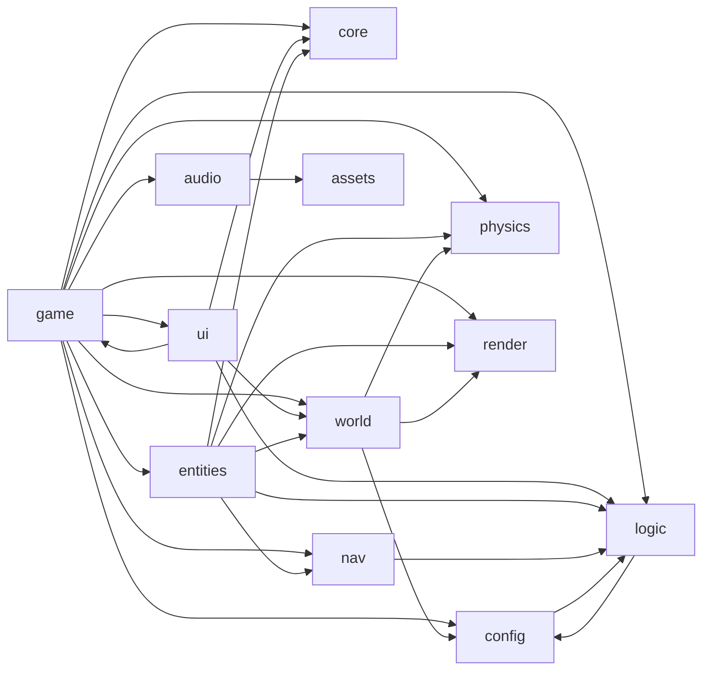

# 依赖

## 外部依赖

| 包 | 版本（精确锁定） | 类型 | 使用位置 |
| --- | --- | --- | --- |
| `three` | 0.186.1 | 运行时 | `render/`、`world/cityBuilder.ts`、`entities/`、`game/`、`ui/hud.ts`、`audio/` |
| `@dimforge/rapier3d-compat` | 0.21.0 | 运行时 | `physics/world.ts`、`physics/raycast.ts`，类型被 `entities/zombie*.ts`、`world/cityBuilder.ts` 引用 |
| `typescript` | 5.9.3 | 开发 | 类型检查 |
| `vite` | 7.3.7 | 开发 | 构建 / 开发服务器 |
| `vitest` | 5.0.5 | 开发 | 单元测试 |
| `@types/three` | 0.186.0 | 开发 | 类型 |

运行时没有网络依赖；音效文件在 `public/assets/audio/`（CC0，来源见 `docs/资源来源.md`）。

## 内部模块依赖

文本说明：`game` 依赖所有层；`entities` 依赖 core / logic / nav / physics / render / world；`world` 依赖 config 类型、physics 与 render 材质；`nav` 只依赖 `logic/math`；`logic` 只依赖 config 类型。

## 需要注意的耦合

- **`ui/hud.ts` ↔ `game/session.ts`**：HUD 以类型方式 import `Session` 并直接读取其公开字段（`wallet`、`plants`、`gun`、`inventory`、`zombies` 等）；只是类型引用，无运行时循环。
- **`config/validate.ts` → `logic/zombiePose.ts`、`logic/zombieAbilities.ts`**：校验调用姿态与能力模块的纯函数（`deathDuration`、`headCenterHeight`、`allMoveSpeeds`）；`logic` 反向只引用 config 类型，没有运行时循环。
- **`world/layout.ts` 被 `entities/zombie.ts` 依赖**：僵尸用 `buildingAt` 判断室内 / 室外航点标签（`in:<buildingId>` / `outdoor` / `door`），新地图的节点标签必须遵守同一约定。
- **`entities/plants.ts` → `entities/zombieManager.ts`**：坚果墙放置后调用 `zombies.invalidatePaths`。
- **全局单例 `store`**：几乎所有模块直接读 `store.config`；同一时刻只能有一份配置（一张地图）。
